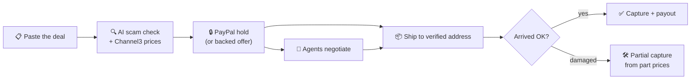

<div align="center">

<picture>
  <source media="(prefers-color-scheme: dark)" srcset="docs/assets/logo-dark.svg">
  
</picture>

# Handshake

### Buy from strangers. Keep your money.

AI catches the scam before money moves. PayPal holds the money until the item really arrives.<br>
Agents negotiate a fair price, and every deadline enforces itself.

<br>

[](https://handshake-5rkw.onrender.com)
[](https://github.com/Yashasm18/HandShake/actions/workflows/ci.yml)
[](LICENSE)

**Powered by**

[](docs/sponsors/paypal.md)
[](docs/sponsors/channel3.md)
[](docs/sponsors/render.md)
[](docs/sponsors/ai.md)
[](docs/sponsors/ai.md)

**Built with**


<br>

[Live demo](https://handshake-5rkw.onrender.com) · [Try it in 60 seconds](#-try-it-in-60-seconds) · [How it works](#-how-it-works) · [Architecture](docs/ARCHITECTURE.md) · [Security](SECURITY.md)

</div>

---

## 🧩 The problem

Americans lost a record **$15.9B to fraud in 2025**, and online shopping scams are the **#2** most reported kind. Buying from a stranger on Marketplace, WhatsApp or Reddit usually ends one of three ways: you pay with *Friends & Family* and get **zero protection**, the item never arrives, or it arrives broken and you fight a 30-day dispute.

**Handshake** is a protected deal room for buying and selling physical goods with people you don't know.

## ✨ What it does

| | Feature | How |
|---|---|---|
| 🔍 | **Scam check** | Paste the chat or a screenshot. AI flags Friends & Family pressure, fake urgency, overpayment and address swaps, quoting the exact words. |
| 🏷️ | **Real-price check** | Live prices from 25,000+ stores. A phone at 64% under retail is flagged as bait. |
| 🔒 | **PayPal hold** | The buyer's money is a PayPal authorization: reserved, never sent, until the item arrives. |
| 🤝 | **Agent negotiation** | The buyer backs an offer with a hold at a secret max. Two AI agents haggle with real prices, and code keeps both inside their limits. |
| 📦 | **Label check** | The seller's shipping label is read and matched to the buyer's PayPal-verified address before anything ships. |
| 🛠️ | **Fair damage refunds** | A photo of the damage, priced from real replacement parts, settles in minutes with a partial capture. |
| ⏱️ | **Self-enforcing deadlines** | No shipment in 3 days? Released. Buyer silent after a verified delivery? Paid. Run by a Render Workflow. |

> **The AI advises. Code moves the money.** Models read, argue and suggest; every amount, limit and refund is computed in code, tested, and paid through PayPal.

## 🚀 Try it in 60 seconds

Everything runs on the **PayPal sandbox**: no real money moves.

1. Open the **[live demo](https://handshake-5rkw.onrender.com)** and choose **I'm selling**. Paste a listing, for example:
   > *Selling my Nintendo Switch OLED (white), $230. Small scuff on the back, screen perfect, both Joy-Cons, dock and charger included.*
2. Create the deal. Leave **Let my agent take offers** on and set a lowest price (say $190).
3. Copy the deal link and open it in a **private window**. You're now the buyer.
4. Choose **Make an offer**, set a secret max ($215), and click **Back the offer with PayPal's sandbox test card**. Watch the two agents negotiate live.
5. Back in the seller's window, add a tracking number and mark it shipped.
6. In the buyer's window, confirm delivery, or **report a problem** with a photo to see a fair partial refund.

The **PayPal sandbox record** on the deal page shows the real order, authorization, capture and payout ids.

## ⚙️ How it works



Deadlines run underneath every step, enforced by a [Render Workflow](docs/sponsors/render.md). The full state machine, data flow and design rules are in **[docs/ARCHITECTURE.md](docs/ARCHITECTURE.md)**.

## 🤝 Built with our partners

Each partner powers a different part of a safe deal. Click through for exactly what we used, how it works inside Handshake, what we liked, and credits.

<table>
  <tr>
    <td width="50%" valign="top">
      <h3><a href="docs/sponsors/paypal.md">PayPal</a></h3>
      <b>Holds, captures, payouts.</b> Seven PayPal REST calls take a deal from a reserved hold to a paid seller, with partial captures for damage, reauthorization for long shipments, and idempotency on every call.<br><br>
      <a href="docs/sponsors/paypal.md"><b>How Handshake uses PayPal →</b></a>
    </td>
    <td width="50%" valign="top">
      <h3><a href="docs/sponsors/channel3.md">Channel3</a></h3>
      <b>Real prices, three jobs.</b> Live product data from 25,000+ stores catches bait prices, sets the agents' fair range, and prices damaged parts for refunds.<br><br>
      <a href="docs/sponsors/channel3.md"><b>How Handshake uses Channel3 →</b></a>
    </td>
  </tr>
  <tr>
    <td width="50%" valign="top">
      <h3><a href="docs/sponsors/render.md">Render</a></h3>
      <b>Hosting that keeps promises.</b> An always-on web service, a persistent disk, tests that gate every deploy, and a Render Workflow plus cron that enforce every deal deadline.<br><br>
      <a href="docs/sponsors/render.md"><b>How Handshake uses Render →</b></a>
    </td>
    <td width="50%" valign="top">
      <h3><a href="docs/sponsors/ai.md">Claude via OpenRouter</a></h3>
      <b>Reads, argues, never pays.</b> Vision and structured outputs for scam checks, label reading, damage review and agent negotiation, all validated with Zod.<br><br>
      <a href="docs/sponsors/ai.md"><b>How Handshake uses AI →</b></a>
    </td>
  </tr>
</table>

## 🛡️ Safety by design

- **Holds, not payments.** Handshake never holds funds; PayPal does.
- **Code-computed money.** Refunds are capped by verdict and can never exceed what was paid.
- **Idempotent and resumable.** Per-deal locks, PayPal request ids and step-by-step settlement mean retries never charge twice.
- **Private by default.** Roles come from HttpOnly cookies; addresses, emails and each side's negotiation limit are only shown to the people allowed to see them.
- **Prompt-injection resistant.** Strangers' text is untrusted evidence; a code referee checks every agent offer and message.

Full threat model and the issues we've found and fixed: **[SECURITY.md](SECURITY.md)**.

## 🧪 Tests and CI

**52 tests** cover the rules that move money: part pricing (built on real Channel3 results), refund caps, negotiation limits and leak filters, and every deadline, including exactly-once behavior under retries and concurrent runs.

- **GitHub Actions** runs lint, type check, tests and a production build on every push and pull request.
- **Render** runs the tests again before every deploy, so a failing rule never reaches the live site.
- **CodeQL** and **Dependabot** watch the code and its dependencies.

```bash
npm --prefix web test
npm --prefix workflows test
```

## 💻 Run it locally

Requires **Node 22+** and free sandbox keys for PayPal, Channel3 and OpenRouter.

```bash
git clone https://github.com/Yashasm18/HandShake.git
cd HandShake
cp .env.example .env          # add your sandbox keys
cd web && ln -s ../.env .env.local
npm install
npm run dev                   # http://localhost:3000
```

Tip: set `TIMER_SCALE=0.0007` in `.env` to make a day pass in about a minute when trying the deadlines.

## ☁️ Deploy

[`render.yaml`](render.yaml) is a Render Blueprint for the whole system: the web service with its disk, the deadline workflow, the cron job, and a generated shared secret. Connect the repo as a Blueprint, add the secrets it asks for, and add a Render API key to the cron job.

## 📁 Project structure

```
web/                 Next.js app: pages, API routes, PayPal, Channel3 and AI clients
  src/lib/server/    flows (state machine), paypal, negotiate, timers, checks
  test/              Vitest suites for every money rule
workflows/           Render Workflow tasks and the cron trigger
docs/                Architecture and partner write-ups
scripts/             One-off PayPal sandbox checks
render.yaml          Render Blueprint
```

## 🤲 Contributing

Contributions are welcome. Please read **[CONTRIBUTING.md](CONTRIBUTING.md)** for setup, the ground rules for money-moving code, and the pull request checklist. Security issues go through **[SECURITY.md](SECURITY.md)**.

## 📜 License

[MIT](LICENSE) © Yashas M

<div align="center">
<br>
Built for the <a href="https://paypalaihackathon.devpost.com/">PayPal AI Hackathon</a>.
</div>
