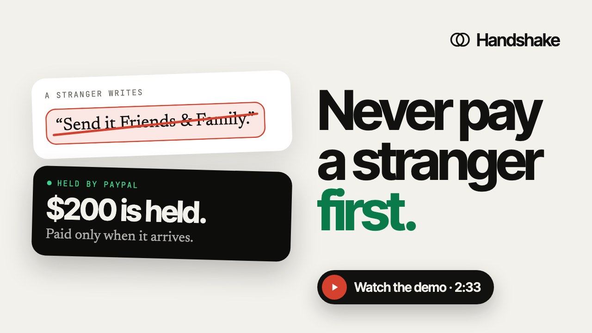
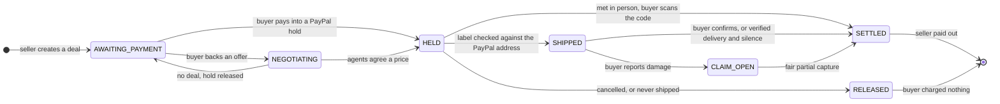
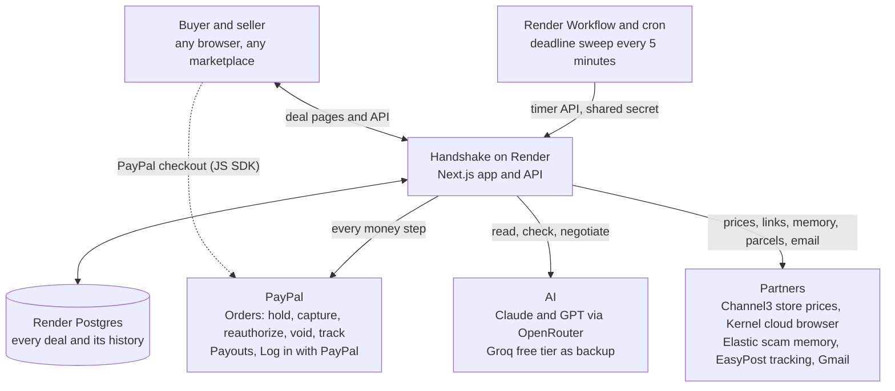

<div align="center">

<picture>
  <source media="(prefers-color-scheme: dark)" srcset="docs/assets/logo-dark.svg">
  
</picture>

# Handshake

### Trust the deal, not the stranger.

AI catches the scam before money moves. PayPal holds the money until the item really arrives.<br>
Agents negotiate a fair price, and every deadline enforces itself.

<br>

[](https://usehandshake.onrender.com)
[](https://github.com/Yashasm18/HandShake/actions/workflows/ci.yml)
[](LICENSE)

**Powered by**

[](docs/sponsors/paypal.md)
[](docs/sponsors/channel3.md)
[](docs/sponsors/render.md)
[](docs/sponsors/kernel.md)
[](docs/sponsors/elastic.md)

**Built with**

[](docs/AI.md)
[](docs/AI.md)
[](docs/AI.md)


<br>

[Live demo](https://usehandshake.onrender.com) · [Watch the demo (2:33)](https://youtu.be/qnwLbxLTqNE) · [Try it in 60 seconds](#try-it-in-60-seconds) · [How it works](#how-it-works) · [Architecture](#architecture) · [Security](SECURITY.md) · [The build story](BLOG.md)

</div>

---

## Watch the demo

<a href="https://youtu.be/qnwLbxLTqNE"></a>

**[Watch on YouTube](https://youtu.be/qnwLbxLTqNE)** (2:33, narrated, recorded on the live site). AI stops a scam before any money moves, then an honest deal goes from listing to payout: a PayPal hold, two AI agents negotiating inside secret limits, a shipping label checked against the buyer's PayPal address, and PayPal capture and Payouts.

## The problem

You find a used Nintendo Switch on Marketplace for $230. The seller is friendly and quick to reply. Then come the messages:

> *"Still available! I'm out of town so I'll ship it. Send it Friends & Family so there are no fees, and please do it in the next 30 minutes, two other people are asking."*

Now you have to choose, and every choice is bad:

- **Pay Friends & Family**, and you have **no protection at all**. If the Switch never comes, the money is gone.
- **Pay with buyer protection**, and the seller may refuse, or you end up in a dispute that takes weeks while your money is stuck.
- **Meet in person with cash**, and you carry hundreds of dollars to meet a stranger, and still can't be sure the item works.

Honest sellers have it just as bad: fake "payment sent" screenshots, buyers who claim the box arrived empty, and chargebacks weeks after the sale.

This isn't rare. Americans reported a record **$15.9B lost to fraud in 2025** (FTC), and online shopping was the **#2** most reported kind of fraud in 2024. Most of it starts exactly like this, with a stranger, a good price and a little pressure.

**The real problem is that trust has to come first.** One side has to send money, or an item, before they know the other side is honest.

## The solution: Handshake

**Handshake removes that first leap of trust.** It's a protected deal room for buying and selling physical goods with someone you don't know, on any marketplace, chat or forum.

1. **Check the deal first.** Paste the chat, a screenshot or the listing link. AI reads it for scam tricks, real store prices show whether the price is bait, and scam memory recognises sellers who have tried this before.
2. **The money is held by PayPal, not sent.** The buyer pays into a PayPal hold. The seller can see the money is real; nobody can take it yet.
3. **Proof before payment.** The seller's shipping label is read by AI and checked against the buyer's PayPal-verified address, and the parcel is followed with the carrier. Meeting in person instead? The buyer checks the item, then scans the seller's one-time code.
4. **Only a fair amount ever moves.** If it arrives as described, PayPal captures the payment and pays the seller. If it's damaged, a photo is priced against real replacement parts and only the fair amount is captured; the rest goes back to the buyer.

Underneath, **every deadline enforces itself**: a seller who never ships has the hold released automatically, and a buyer who goes quiet after a verified delivery can't keep the seller waiting forever. A day before any deadline acts, the person who has to act gets a reminder.

### Why it's different

| Today | With Handshake |
|---|---|
| Buyer protection helps **after** you've been scammed, through a dispute | Handshake **stops the scam before money moves**, and the money is never sent until the item arrives |
| "I shipped it" is a promise, and tracking numbers can be faked or reused | The **label is checked against the buyer's PayPal address**, and fake, reused or misdelivered parcels block the payout |
| Haggling happens in chat, under pressure | Two **AI agents negotiate a fair price** from real store prices, with the buyer's money already held, and code keeps both inside their owners' secret limits |
| Each scam victim is on their own | Every scam caught is **remembered**, so the same words, phone number or photo warn the next buyer |
| Marketplace checkouts only work on that marketplace | Handshake works **anywhere**: a link is all either side needs |

### Who it's for

People buying and selling secondhand electronics, games, bikes, tickets and collectibles on Facebook Marketplace, Craigslist, OfferUp, Reddit and WhatsApp groups, and the honest sellers who want buyers to trust them.

## At a glance

| Area | What it is |
|---|---|
| **Live demo** | [usehandshake.onrender.com](https://usehandshake.onrender.com) (PayPal sandbox, test mode: no real money moves) |
| **PayPal** | Orders (authorize, capture, partial capture, reauthorize, void, tracking), Payouts, Log in with PayPal, and the PayPal JS SDK. [Details](#paypal-in-handshake) |
| **AI** | Reads scam chats and screenshots, shipping labels and damage photos, and runs two negotiating agents. Claude through OpenRouter, with Groq's free tier as the backup. [Details](#ai-in-handshake) |
| **Partners** | Channel3 (real prices), Render (hosting, Postgres, Workflows), Kernel (cloud browser), Elastic (scam memory) |
| **Quality** | 315 automated tests, 42 live end-to-end scenarios on the PayPal sandbox, and an attack pass on the live site. [Testing](docs/TESTING.md) |

## Try it in 60 seconds

Everything runs on the **PayPal sandbox**: no real money moves, and no sign-in is needed.

1. Open the **[live demo](https://usehandshake.onrender.com)**, choose **Check a deal**, tap **A scam chat**, then **Check this deal**. Handshake explains every trick it finds.
2. Switch to **I'm selling**, paste a listing and choose **Check my listing**, for example:
   > *Selling my Nintendo Switch OLED (white), $230. Small scuff on the back, screen perfect, both Joy-Cons, dock and charger included.*
3. Choose **Create a protected deal** and continue as a **demo seller** (just type a first name). Leave **Let my agent take offers** on, set a lowest price (say $190), and choose **Create deal link**.
4. Copy the deal link and open it in a **private or incognito window**. You're the buyer there.
5. Choose **Make an offer**, set a secret max (say $215), and back it with **PayPal's sandbox test card**. Watch the two agents negotiate live.
6. Back in the seller's window, pick the **Delivered** test parcel and choose **Mark as shipped**.
7. In the buyer's window, choose **Yes, release payment**, or **Report a problem** with a photo to see a fair partial refund. Within a minute the seller's window shows **You've been paid**.

The **PayPal sandbox record** on each deal shows the real order, authorization, capture and payout ids. Sandbox PayPal logins for trying **Sign in with PayPal** are in the Devpost submission; real PayPal accounts can't sign in to the sandbox.

## How it works

Every deal follows the same path. PayPal holds the money at every step until there's a reason to move it.



| Step | What happens | PayPal | AI and partners |
|---|---|---|---|
| **Check** | The chat, screenshot or link is checked for scam tricks and bait prices | Nothing moves yet: no money is touched until the deal looks safe | AI reads it; Channel3 prices it; Elastic remembers it; Kernel opens links |
| **Hold** | The buyer pays, or backs an offer at a secret maximum | Order with `intent: AUTHORIZE` | None: holding the money is PayPal's job alone |
| **Negotiate** (optional) | Two agents haggle within both owners' secret limits | The hold sits at the buyer's max | AI agents, refereed by code |
| **Ship or meet** | The label must match the buyer's PayPal address; the parcel is tracked. Or the buyer scans the seller's code at a meetup | Verified shipping address from the order | AI reads the label; EasyPost tracks the parcel |
| **Settle** | The fair amount is captured and the seller is paid | Capture (full or partial), tracking attached, Payout | AI prices damage from Channel3 part prices |
| **Deadlines** | Ship-by, renewals, release on silence and payout retries run on their own | Reauthorize, void | Render Workflow, every 5 minutes |

> **The AI advises. Code moves the money.** Models read, argue and suggest; every amount, limit and refund is computed in code, tested, and paid through PayPal.

### Features

| Feature | How |
|---|---|
| **Scam check** | Paste the chat or a screenshot. AI flags Friends & Family pressure, fake urgency, overpayment, address swaps and fake payment links, quoting the exact words |
| **Real-price check** | Live prices from 25,000+ stores (Channel3). A phone 64% under retail is flagged as bait; other models of the product (Pro, Max, Lite, bundles) are left out of the comparison |
| **Paste a link** | A Kernel cloud browser reads a Marketplace, Craigslist or OfferUp listing and checks whether its photos are the seller's own or copied from a store |
| **Scam memory** | Every scam caught is remembered in Elasticsearch. The same tactics in new words, a reused phone number or Cash App tag, or a reused photo are recognised; two buyers' reports make it a known scam |
| **PayPal hold** | The buyer's money is a PayPal authorization: reserved, never sent, until the item arrives |
| **Agent negotiation** | The buyer backs an offer with a hold at a secret max. Two agents argue from Handshake's own price lookup, and a code referee keeps both inside their limits |
| **Label check** | The shipping label is read and matched to the buyer's PayPal-verified address before it counts as shipped. Instructions printed on a label to fool the AI don't work |
| **Live delivery tracking** | EasyPost follows the parcel. The buyer's check window starts at the delivery scan; fake, reused or misdelivered parcels block the payout |
| **Meet in person** | The buyer checks the item, then scans the seller's one-time code. PayPal captures and pays the seller on the spot. No cash, no fake payment screenshots |
| **Fair damage refunds** | A photo of the damage, priced from real replacement parts, settles with a partial capture. The refund is capped and can never exceed what was paid |
| **Self-enforcing deadlines** | Ship-by, hold renewals, release on verified silence and payout retries, run by a Render Workflow even if nobody opens the page |
| **Reminder emails** | A day before a deadline acts, the person who has to act hears exactly when and what happens otherwise |
| **Sign in with PayPal** | Sellers sign in on PayPal's own page and are paid into their own PayPal by payer id. Buyers see a "Verified PayPal" badge; My deals works on any device |
| **Email updates** | Each side hears when the deal needs them. Typed-in addresses are confirmed from the inbox first |
| **Payouts that heal themselves** | A payout PayPal refuses is retried with backoff; one PayPal is still processing is checked every 30 seconds. The seller is told they're paid only once PayPal confirms it |
| **Live status page** | [/status](https://usehandshake.onrender.com/status) checks every service with a real request; outages and recoveries are emailed to the team |
| **Test mode** | A bar on every page says it's the PayPal sandbox, and every sign-in button says a sandbox account is needed |

## Architecture

One Next.js app on Render holds all deal state and all PayPal credentials. A Render Workflow enforces deadlines by asking the app to act; partners are called from the server only.



**Design rules**

1. **AI advises, code moves money.** Models return structured data checked against a schema; amounts, limits and refunds are computed in code.
2. **The app is the only writer.** The workflow asks the app to act, and the app re-checks every rule before it does.
3. **Every money step is idempotent and resumable.** Per-deal Postgres locks, PayPal request ids and step-by-step settlement mean a retry never charges or pays twice.
4. **Roles come from the browser, never the request body.** Signed HttpOnly cookies, or the PayPal account linked to each side.
5. **Every rule that moves money has a test**, and the tests gate every deploy.

The full data model, storage and file map are in **[docs/ARCHITECTURE.md](docs/ARCHITECTURE.md)**.

## PayPal in Handshake

PayPal is the engine of every deal: take it out and nothing works. Handshake makes **nine PayPal REST calls**, and the buyer pays through **PayPal's own checkout buttons**.

| Step | PayPal API | Why |
|---|---|---|
| Sign in | `POST /v1/oauth2/token` (authorization code) | Log in with PayPal: the seller signs in on PayPal's page; Handshake never sees a password |
| Know who's paid | `GET /v1/identity/oauth2/userinfo` | The seller's verified status and payer id, where their payout goes |
| Reserve | `POST /v2/checkout/orders` with `intent: AUTHORIZE` | The hold at the deal price, or at the buyer's secret max for an offer |
| Confirm | `POST /v2/checkout/orders/{id}/authorize` | Turns the buyer's approval into a hold, with their PayPal-verified shipping address |
| Keep reserved | `POST /v2/payments/authorizations/{id}/reauthorize` | Renews the hold after PayPal's 3-day honor period |
| Charge what's fair | `POST /v2/payments/authorizations/{id}/capture` | The full price, the agreed price, or less after a damage refund; PayPal releases the rest |
| Prove it shipped | `POST /v2/checkout/orders/{id}/track` | Attaches the carrier and tracking number to the payment |
| Pay the seller | `POST /v1/payments/payouts` | Sends the seller's share into their own PayPal account |
| Confirm the payout | `GET /v1/payments/payouts/{batch_id}` | The seller is told they're paid only once the payout item completes |
| Release | `POST /v2/payments/authorizations/{id}/void` | Cancels the hold when a deal is cancelled, never shipped, or the agents can't agree |

Every call that moves money carries an idempotency key, and PayPal's own records match Handshake's to the cent (checked in the [final test pass](docs/TESTING.md#final-break-it-pass-nov-6-2026)). Sequence diagrams and setup: **[docs/sponsors/paypal.md](docs/sponsors/paypal.md)**.

## AI in Handshake

| Job | The AI reads | It returns | Code then decides |
|---|---|---|---|
| **Scam check** | A pasted chat, screenshot or listing page | Red flags, each with the exact quote and why it matters | The risk level, with Channel3's price gap and scam memory |
| **Label check** | A photo of a shipping label | Recipient, address, carrier, tracking number | Whether it matches the buyer's PayPal-verified address |
| **Damage review** | The buyer's photo, their note and the listing | What's wrong, which part, and a search for that part | The refund: the real part price, capped, never above what was paid |
| **Negotiation** | Real prices, the owner's secret limit, the history | One message and one offer per turn | Whether the offer is allowed; the referee clamps or rejects it |

**Models.** Claude Haiku 5.5 through [OpenRouter](https://openrouter.ai), with GPT-6 Luna as a fallback; if those can't answer, Groq's free tier (Qwen) takes over. Every answer must match a strict JSON schema and is validated with Zod before code uses it. If no model can answer, the step stops with nothing moved and the person is told to try again shortly. Scam memory uses Elastic's built-in Jina models for meaning, reranking and photos.

**Guardrails.** Everything a stranger wrote is passed to the model as untrusted evidence, never instructions. Agents only ever see their own owner's limit, and any message that hints at it is rejected. People's chats and addresses are only sent to providers whose published policy is not to store or train on requests.

**AI tools used to build it.** Handshake was built by one developer with **Claude Code** as a pair programmer, which is why commits are co-authored by Claude.

More: **[docs/AI.md](docs/AI.md)**.

## Built with our partners

Each partner powers a different part of a safe deal. Click through for exactly what we used, how it works inside Handshake, and what we liked.

<table>
  <tr>
    <td width="50%" valign="top">
      <h3><a href="docs/sponsors/paypal.md">PayPal</a></h3>
      <b>Holds, captures, payouts.</b> Nine PayPal calls take a deal from a reserved hold to a paid seller, with partial captures for damage, reauthorization for long shipments, Log in with PayPal, and idempotency on every money step.<br><br>
      <a href="docs/sponsors/paypal.md"><b>How Handshake uses PayPal →</b></a>
    </td>
    <td width="50%" valign="top">
      <h3><a href="docs/sponsors/channel3.md">Channel3</a></h3>
      <b>Real prices, three jobs.</b> Live product data from 25,000+ stores catches bait prices, gives the agents a fair range, and prices damaged parts for refunds.<br><br>
      <a href="docs/sponsors/channel3.md"><b>How Handshake uses Channel3 →</b></a>
    </td>
  </tr>
  <tr>
    <td width="50%" valign="top">
      <h3><a href="docs/sponsors/render.md">Render</a></h3>
      <b>Hosting that keeps promises.</b> The always-on web service, Render Postgres for every deal, tests that gate every deploy, and a Render Workflow plus cron that enforce every deadline.<br><br>
      <a href="docs/sponsors/render.md"><b>How Handshake uses Render →</b></a>
    </td>
    <td width="50%" valign="top">
      <h3><a href="docs/sponsors/kernel.md">Kernel</a></h3>
      <b>Paste a link, not a screenshot.</b> A cloud browser opens the listing, reads its price and photos, and catches sellers who post store photos instead of the real item.<br><br>
      <a href="docs/sponsors/kernel.md"><b>How Handshake uses Kernel →</b></a>
    </td>
  </tr>
  <tr>
    <td colspan="2" valign="top">
      <h3><a href="docs/sponsors/elastic.md">Elastic</a></h3>
      <b>A memory for scams.</b> Elasticsearch remembers every scam Handshake catches. Jina embeddings and the Jina reranker match the same tactics in new words, exact search catches reused phone numbers and Cash App tags, and Jina CLIP recognises reused photos.<br><br>
      <a href="docs/sponsors/elastic.md"><b>How Handshake uses Elastic →</b></a>
    </td>
  </tr>
</table>

## Safety by design

- **Holds, not payments.** Handshake never holds funds; PayPal does, and money moves only when the deal says it should.
- **Code-computed money.** Refunds are capped by verdict and can never exceed what was paid; refund plus capture always equals the price.
- **Idempotent and resumable.** Per-deal locks across servers, PayPal request ids and step-by-step settlement mean retries never charge twice.
- **Real accounts.** Sellers sign in with PayPal on PayPal's own page and are paid into their own account. Sessions are HMAC-signed HttpOnly cookies; Handshake never sees a password.
- **Private by default.** Addresses, emails, PayPal ids and each side's negotiation limit are only shown to the people allowed to see them.
- **Trustworthy checks.** A scam check is sealed by the server, so a seller can't forge a clean one, and a seller's own check is never shown to buyers as a badge.
- **Hardened web layer.** A content security policy, HTTPS-only, no framing, cross-site requests refused, and rate limits on every paid call.
- **Prompt-injection resistant.** Strangers' text is untrusted evidence, and a code referee checks every agent offer and message.

The threat model and every issue we've found and fixed: **[SECURITY.md](SECURITY.md)**.

## Tests and quality

Handshake is tested three ways: **315 automated tests** that run on every push and deploy (307 for the app, each run on both the file store and Postgres, plus 8 for the deadline workflow), **42 live end-to-end scenarios** against the real PayPal sandbox, Channel3, Kernel, Elastic, EasyPost and the AI models, and a final **attack pass on the live site**.

| Area | Automated | Live | What it proves |
|---|---:|---:|---|
| Deals, meetups and settlement | 37 | 9 | Holds, captures, payouts and voids happen once, for the right amount, in the right state; meetup codes work once, expire and lock after 5 wrong tries |
| Refunds and pricing | 26 | 3 | Refunds come from real part prices, are capped, and refund plus capture always equals the price; price comparisons ignore accessories and other models |
| Agent negotiation | 21 | 3 | Agents never cross or leak a secret limit, argue from Handshake's own prices, and PayPal captures exactly the agreed price |
| Privacy, access and hardening | 30 | 3 | Strangers and the wrong party get 403; forged scam checks, cross-site requests and bad input are refused; security headers are set |
| AI checks and providers | 12 | 5 | Scam chats and bait prices are flagged; a label to the wrong address is stopped, even one that tries to instruct the AI; the backup takes over; an outage moves nothing |
| Deadlines and the Render Workflow | 25 | 1 | Every deadline fires exactly once, survives retries and concurrent runs |
| Sign in with PayPal | 27 | 2 | Sessions can't be forged or replayed; sign-in can't be started by another site or bounce off-site; sellers are paid into their own PayPal |
| Emails and reminders | 36 | 2 | Each step and each reminder reaches only the person who has to act, once; unconfirmed or muted addresses get nothing |
| Delivery tracking | 28 | 4 | Each carrier status moves the deal correctly; fake, reused or misdelivered parcels never pay out on silence |
| Listing links (Kernel) | 20 | 3 | Only public pages are opened, every browser is closed, store photos are flagged |
| Scam memory (Elastic) | 21 | 6 | Reworded scams, reused details and photos are recognised; nobody can brand a seller with one fake report |
| Status and alerts | 15 | 1 | Live checks, one alert per outage and recovery, and nothing secret ever shown |
| Database (Postgres) | 9 | all 42 | Schema and indexes, locking under concurrent clicks, and tests that can never reach a real database; every live scenario runs on the production Postgres |

The live runs and the final attack pass found real bugs, including a forgeable scam check and a test run that reached the production database, and every one is fixed and covered by a test. Results, PayPal sandbox ids and how to re-run them: **[docs/TESTING.md](docs/TESTING.md)**.

- **GitHub Actions** runs lint, type check, both test suites, the test-count check and a production build on every push.
- **Render** runs the tests again before every deploy, so a failing rule never reaches the live site.
- **CodeQL** and **Dependabot** watch the code and its dependencies.

## What's next

Handshake runs end to end on the PayPal sandbox today. Taking it to real money, and further:

1. **Go live on PayPal.** A production PayPal app, with sellers onboarded through PayPal's **multiparty platform**, so the buyer's payment goes straight to the seller at capture, with Handshake's fee split off in the same step, instead of a separate payout.
2. **Disputes, end to end.** A claim either side declines goes to **PayPal's Resolution Center** through the Disputes API, with the photos, label check and tracking already attached as evidence.
3. **Share to Handshake.** A share-sheet app and browser extension, so a buyer can check a Marketplace listing or WhatsApp chat in one tap, without copying anything.
4. **Agents that shop for you.** With PayPal's **Agent Toolkit**, a buyer's own AI assistant could find a listing, check it, back an offer and complete the deal through Handshake, with the same limits and holds.
5. **More ways to pay.** Venmo for buyers in the US, and PYUSD for cross-border deals.
6. **A shared scam memory.** Marketplaces and communities contributing reports, with appeals and human review, so one person's bad experience protects everyone.
7. **Scale.** Shared rate limits and multiple servers, and per-request content-security nonces, as traffic grows.

The full story of how it was built, and why: **[BLOG.md](BLOG.md)**.

## Run it locally

Requires **Node 22+**, a free [PayPal Developer](https://developer.paypal.com) account, and free keys for [Channel3](https://trychannel3.com/developers) and [OpenRouter](https://openrouter.ai/keys). Kernel (pasted links), Elastic (scam memory), EasyPost (tracking), Groq (AI backup) and Gmail (emails) are optional: without them, those features step aside and everything else works.

```bash
git clone https://github.com/Yashasm18/HandShake.git
cd HandShake
cp .env.example .env          # then fill in the keys below
cd web && ln -s ../.env .env.local
npm install
npm run dev                   # http://localhost:3000
```

In `.env`, the minimum is:

| Setting | Where it comes from |
|---|---|
| `PAYPAL_CLIENT_ID`, `PAYPAL_CLIENT_SECRET` | PayPal Developer Dashboard → Apps & Credentials → a **Sandbox** app |
| `SELLER_EMAIL` | Dashboard → Testing Tools → Sandbox Accounts: a sandbox account that receives demo sellers' payouts |
| `CHANNEL3_API_KEY` | Channel3 developer dashboard |
| `OPENROUTER_API_KEY` | OpenRouter → Keys |

Then try a whole deal locally with the steps in [Try it in 60 seconds](#try-it-in-60-seconds), at `http://localhost:3000`. If a check says the AI is unavailable, the terminal running `npm run dev` names the missing key.

Without `DATABASE_URL`, deals are kept in a local JSON file (`web/.data`); with it, in Postgres. Locally there's no deadline workflow, so opening a deal enforces any deadline that has passed; set `TIMER_SCALE=0.0007` to make a day pass in about a minute. To start scam memory with common scam scripts: `cd web && npx tsx --conditions=react-server scripts/seed-memory.mts`.

```bash
npm --prefix web test         # the app suite on the file store
npm --prefix web run test:pg  # the same suite on Postgres (PGlite)
npm --prefix workflows test   # the deadline workflow (run npm --prefix workflows install first)
```

## Deploy

[`render.yaml`](render.yaml) is a Render Blueprint for the whole system: the web service, Render Postgres, the deadline workflow, the cron job and a generated shared secret. Connect the repo as a Blueprint, add the secrets it asks for, and add a Render API key to the cron job.

## Project structure

```
web/                 Next.js app: pages, API routes, and the PayPal, AI and partner clients
  src/lib/server/    flows (the deal state machine), paypal, negotiate, timers, checks, deals (storage)
  test/              Vitest suites for every money rule
workflows/           Render Workflow tasks and the cron trigger
docs/                Architecture, AI, testing, and one page per partner
scripts/             Live end-to-end scenarios and PayPal sandbox checks
video/               The narrated "See how it works" video (Remotion)
render.yaml          Render Blueprint
BLOG.md              The build story
```

## Contributing

Contributions are welcome. Please read **[CONTRIBUTING.md](CONTRIBUTING.md)** for setup, the ground rules for money-moving code, and the pull request checklist. Security issues go through **[SECURITY.md](SECURITY.md)**.

## License

[MIT](LICENSE) © Yashas M

<div align="center">
<br>
Built for the <a href="https://paypalaihackathon.devpost.com/">PayPal AI Hackathon</a>.
</div>
