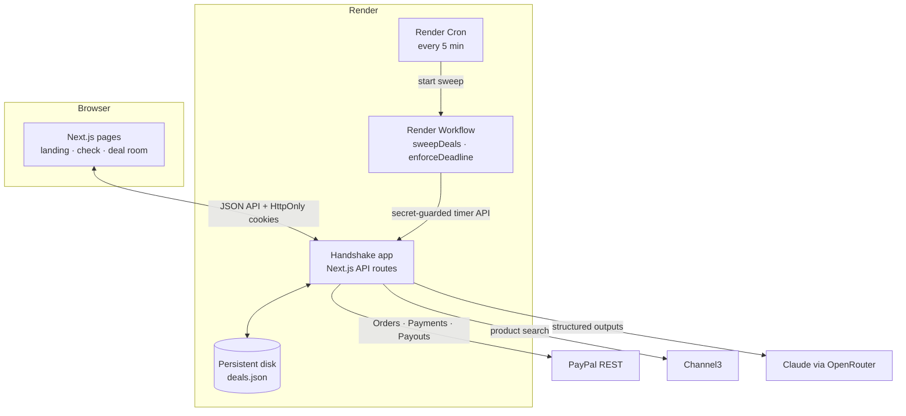
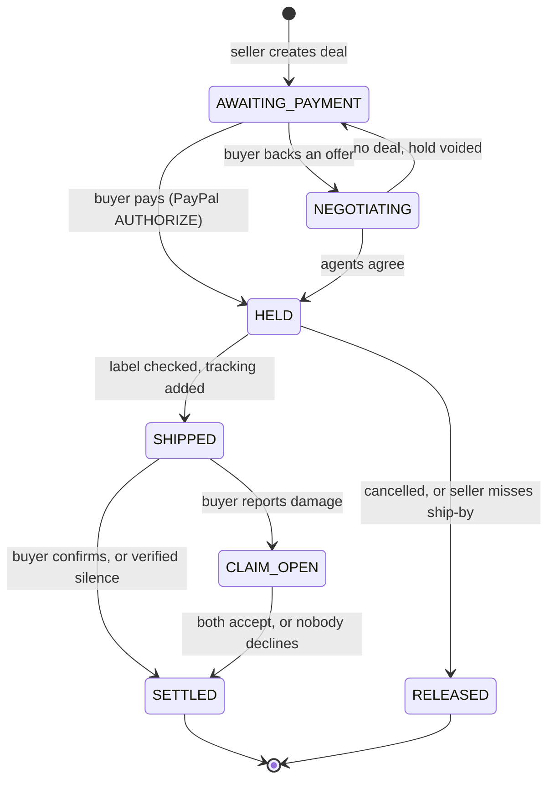

# Architecture

[← Back to README](../README.md)

---

## Overview

Handshake is one Next.js app (frontend and API together) plus a small Render Workflow that enforces deadlines. The app owns all deal state and all PayPal credentials; everything else either reads from it or asks it to act.

## Deal lifecycle

## Where things live

| Path | What it holds |
|---|---|
| [`web/src/app`](../web/src/app) | Pages (`/`, `/check`, `/d/[id]`, `/agents`, `/paypal`, `/channel3`, `/render`) and API routes |
| [`web/src/app/api/deals/[id]/[action]`](../web/src/app/api/deals/%5Bid%5D/%5Baction%5D/route.ts) | Every deal action, each with the role allowed to run it |
| [`web/src/lib/server/flows.ts`](../web/src/lib/server/flows.ts) | The deal state machine: pay, ship, settle, claim, cancel |
| [`web/src/lib/server/paypal.ts`](../web/src/lib/server/paypal.ts) | PayPal REST client with idempotency keys |
| [`web/src/lib/server/negotiate.ts`](../web/src/lib/server/negotiate.ts) | Agent negotiation and its code referee |
| [`web/src/lib/server/timers.ts`](../web/src/lib/server/timers.ts) · [`web/src/lib/deadlines.ts`](../web/src/lib/deadlines.ts) | Deadline rules and the actions that enforce them |
| [`web/src/lib/server/checks.ts`](../web/src/lib/server/checks.ts) · [`channel3.ts`](../web/src/lib/server/channel3.ts) | Scam scan, label and damage review, price data and filters |
| [`web/src/lib/server/auth.ts`](../web/src/lib/server/auth.ts) | Party cookies and the public view of a deal |
| [`web/src/lib/refund.ts`](../web/src/lib/refund.ts) | Refund caps as a pure function |
| [`workflows/`](../workflows) | Render Workflow tasks and the cron trigger |
| [`web/test`](../web/test) · [`workflows/test`](../workflows/test) | Tests for every money rule |

## Design rules

1. **AI advises, code moves money.** Models return structured data; amounts, limits and refunds are computed in code.
2. **The app is the only writer.** Deals live in one place; the workflow asks the app to act and the app re-checks every rule.
3. **Every money step is idempotent.** Per-deal locks, PayPal request ids, and resumable settlement mean retries are always safe.
4. **The browser proves who you are, not the request body.** Roles come from HttpOnly cookies issued to the browser that created or paid for a deal.
5. **Every rule that moves money has a test**, and the tests gate every deploy.

## Storage

Deals are stored as JSON on Render's persistent disk, written atomically (temporary file, then rename) and serialized per deal with an in-process lock. That's deliberate for a single-instance hackathon deployment; moving to Postgres would only change [`deals.ts`](../web/src/lib/server/deals.ts).
