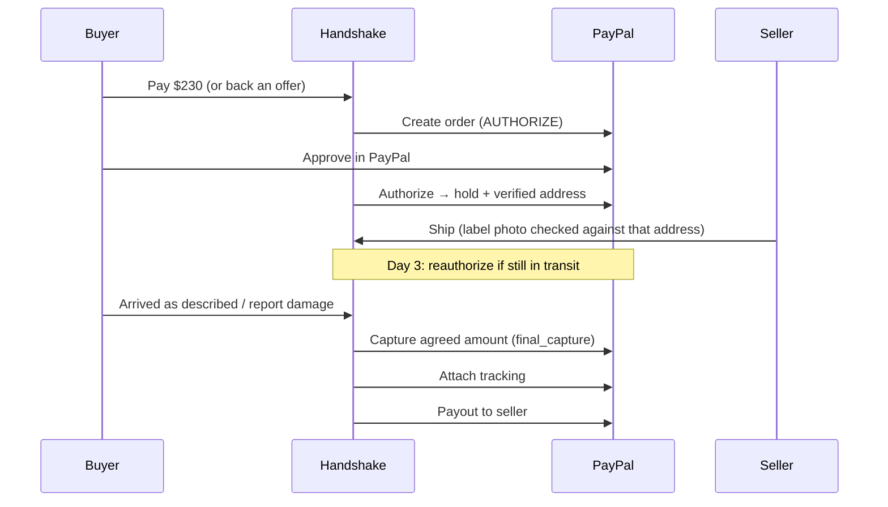

# PayPal in Handshake

**PayPal holds the money. Nobody holds their breath.**

[← Back to README](../../README.md) · [Channel3](channel3.md) · [Render](render.md) · [Kernel](kernel.md) · [Elastic](elastic.md)

---

## Why PayPal

Paying a stranger online usually means trusting them first. Handshake removes that step by putting PayPal in the middle of every deal: the buyer's money is **reserved, not sent**, the seller can see it's real, and only the right amount ever moves, after the item arrives.

Every money movement in Handshake is a PayPal API call. Nothing is simulated: the full lifecycle below has been run end to end on the PayPal sandbox.

## What we use

Handshake makes **nine** PayPal REST calls: two to sign sellers in with PayPal ([`paypal-login.ts`](../../web/src/lib/server/paypal-login.ts)) and seven across a deal ([`paypal.ts`](../../web/src/lib/server/paypal.ts)).

| Step | API | Why Handshake needs it |
|---|---|---|
| Sign in | `POST /v1/oauth2/token` with `grant_type=authorization_code` | **Log in with PayPal.** The seller signs in on PayPal's own page; Handshake swaps the one-time code for a token and never sees a password. |
| Know who's paid | `GET /v1/identity/oauth2/userinfo?schema=paypalv1.1` | Returns the seller's name, email, verification status and **payer id**, which is where their payout goes. Buyers see a "Verified PayPal" badge. |
| Reserve | `POST /v2/checkout/orders` with `intent: AUTHORIZE` | Creates the hold at the deal price, or at the buyer's secret max for an agent-negotiated offer. |
| Confirm | `POST /v2/checkout/orders/{id}/authorize` | Turns the buyer's approval into a hold and returns their **PayPal-verified shipping address**. |
| Keep reserved | `POST /v2/payments/authorizations/{id}/reauthorize` | Renews the hold after PayPal's 3-day honor period, run on schedule by a [Render Workflow](render.md). |
| Charge what's fair | `POST /v2/payments/authorizations/{id}/capture` with `final_capture: true` | Captures the agreed price, or less after a damage refund. PayPal releases the rest of the hold automatically. |
| Prove it shipped | `POST /v2/checkout/orders/{id}/track` | Attaches carrier and tracking to the capture, as PayPal recommends for physical goods; it helps when resolving disputes (Seller Protection eligibility is PayPal's call). |
| Pay the seller | `POST /v1/payments/payouts` | Sends the seller their share after PayPal's fee, into **their own PayPal account** (`recipient_type: PAYPAL_ID`, the payer id). Guest demo sellers are paid into the sandbox seller account by email. |
| Confirm the seller was paid | `GET /v1/payments/payouts/{batch_id}` | A payout request can still be denied after PayPal accepts it. The deal settles, and the seller hears "you've been paid", only once the payout item completes. |
| Release everything | `POST /v2/payments/authorizations/{id}/void` | Cancels the hold when a deal is cancelled, the agents can't agree, or the seller misses the shipping deadline. |

On the client, the **PayPal JS SDK** (`intent=authorize`) renders PayPal's own checkout buttons ([`paypal-button.tsx`](../../web/src/components/paypal-button.tsx)). For judges without a sandbox login, a test-card path funds the same `AUTHORIZE` order with PayPal's published sandbox card.

## Two PayPal apps

Handshake can use two sandbox apps. The **main** app takes payments: orders, holds, captures, tracking and Log in with PayPal. An optional **payouts** app pays sellers from its own business account. PayPal holds incoming payments on new business accounts, so a platform that pays sellers from the same balance it collects into can run dry while the money it took is still on hold; we hit exactly this in testing. Set `PAYPAL_PAYOUT_CLIENT_ID` and `PAYPAL_PAYOUT_CLIENT_SECRET` to split them; without them, payouts use the main app. With PayPal's marketplace program (Multiparty), the buyer's payment would go to the seller directly at capture instead.

## Sign in with PayPal

Sellers sign in with PayPal ([OpenID Connect authorization code flow](https://developer.paypal.com/docs/log-in-with-paypal/)) with the scopes `openid profile email https://uri.paypal.com/services/paypalattributes`.

- **No forged sign-ins.** A random `state` is kept in a signed, 10-minute cookie and must match on the way back, so another site can't sign you into its account. It works once.
- **Signed sessions.** The session is an HMAC-signed HttpOnly, SameSite=Lax cookie that lasts 30 days ([`session.ts`](../../web/src/lib/server/session.ts)). Editing it, or signing it with another key, signs you out.
- **Accounts on deals.** A deal records the seller's payer id, and the buyer's when they pay through PayPal checkout. Either one can open their side of the deal from any device, and **My deals** lists them. Payer ids and emails never reach the browser.
- **No self-dealing.** A seller can't pay for their own deal; if their PayPal account approves the checkout anyway, the hold is voided at once.
- Setup: in the Developer Dashboard, open the app → **Log in with PayPal** → set the Return URL to `https://<host>/api/auth/paypal/callback`, tick Full name, Email, Account verification status and PayPal account ID (payer ID), and set the privacy and user agreement URLs to `/privacy` and `/terms`.

## How a deal moves through PayPal

## Built for real money

- **Idempotent by default.** Every POST carries its own `PayPal-Request-Id`. Captures use one fixed key per authorization and payouts one per deal, so a retry can never charge or pay twice.
- **Resumable settlement.** Capture, tracking and payout are recorded step by step ([`flows.ts`](../../web/src/lib/server/flows.ts) → `settle`). If the payout fails, the retry pays the seller without capturing again, and the captured amount can't be changed afterwards.
- **Checkout bound to one browser.** Starting checkout pins the order to that browser with an HttpOnly cookie, so a stranger who sees an order id can't finish someone else's payment.
- **Amounts set in code.** The AI never decides how much money moves. Captures come from the agreed price and code-capped refund rules ([`refund.ts`](../../web/src/lib/refund.ts)).
- **Seller Protection habits, built in** (eligibility is always PayPal's decision). When the seller photographs the shipping label, it's checked against the buyer's PayPal-verified address and a mismatch is blocked before the item ships. Only a verified label can release payment automatically, and tracking is attached to every capture.

## Verified on the sandbox

| Scenario | Result |
|---|---|
| Full deal: hold, ship, capture, track, payout | Seller paid **$223.55** after a $6.45 fee on a $230 deal |
| Agent-negotiated deal | **$210** captured from a **$215** backed offer, $5 never charged |
| Agents couldn't agree | Hold **voided**, buyer charged nothing |
| Seller missed the shipping deadline | Hold **voided** automatically by the timer workflow |
| Early hold renewal | PayPal said "too soon"; the timer **rescheduled** without failing |

## What we liked

- **Authorize-then-capture is exactly the shape of a safe deal.** A hold that the seller can see but can't touch is the whole product, and PayPal gives it to us as a primitive.
- **One hold, two ways to hand over.** The same authorization covers a shipped deal and a face-to-face meetup: at the meetup the buyer confirms with the seller's one-time code, and Handshake captures and pays out on the spot.
- **Partial capture with `final_capture`.** Damage refunds become one call: capture what's fair, and PayPal returns the rest without a separate refund flow.
- **Verified shipping address on the authorization.** It lets us stop the "ship it to my cousin instead" scam before the item leaves.
- **A sandbox that behaves like production**, including the honor-period rule on reauthorization, which caught a real edge case in our timers.

## Official PayPal resources

- [Orders v2 API](https://developer.paypal.com/docs/api/orders/v2/)
- [Payments v2 API (authorizations, capture, void, reauthorize)](https://developer.paypal.com/docs/api/payments/v2/)
- [Payouts API](https://developer.paypal.com/docs/api/payments.payouts-batch/v1/)
- [Authorize and capture guide](https://developer.paypal.com/docs/checkout/standard/customize/authorization/)
- [Idempotency](https://developer.paypal.com/api/rest/reference/idempotency/)
- [JavaScript SDK](https://developer.paypal.com/sdk/js/)
- [Sandbox card testing](https://developer.paypal.com/tools/sandbox/card-testing/)

## Credits

Built on the **PayPal REST APIs** and **JavaScript SDK**, for the [PayPal AI Hackathon](https://paypalaihackathon.devpost.com/). Thank you to the PayPal developer team for the sandbox, the docs, and the hackathon.
