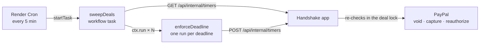

<div align="center">

# Render in Handshake

**Every deal has a clock. Render keeps it ticking.**

[← Back to README](../../README.md) · [PayPal](paypal.md) · [Channel3](channel3.md) · [Kernel](kernel.md) · [Elastic](elastic.md)

</div>

---

## Why Render

Real deals stall: sellers who never ship, buyers who go quiet, PayPal holds that get old. A safe-deals product has to act on its own, at the right time, even when nobody has the page open, and it must never move money twice.

Handshake runs entirely on Render, defined in a single Blueprint ([`render.yaml`](../../render.yaml)), and a **Render Workflow** enforces every deal deadline.

## What we use

| Piece | Render feature | What it does for Handshake |
|---|---|---|
| **Web service** | Node web service, **Starter** plan | Runs the Next.js app and its API. Always on, so a judge's first click is instant. |
| **Render Postgres** | `handshake-db`, reached over Render's private network | Every deal and its history, with indexed lookups and a per-deal advisory lock so two servers never run the same money step. Daily backups. |
| **Persistent disk** | 1 GB disk at `/var/data` | Keeps the original JSON deal file as a backup; it was imported into Postgres once, on the first start with a database. |
| **Tests gate deploys** | `buildCommand: npm ci && npm test && npm run test:pg && npm run build` | The whole suite runs twice before every build, on the file store and on a real Postgres engine. If anything fails, the deploy stops and the live site keeps working. The tests strip every production setting first, so a build can never touch the live database. |
| **Deadline enforcement** | **Render Workflows** (TypeScript SDK) | Two tasks, `sweepDeals` and `enforceDeadline`, with per-run instances and automatic retries. |
| **Scheduler** | **Cron job**, every 5 minutes | Starts each sweep; workflows don't schedule themselves yet. |
| **Shared secret** | Blueprint **environment group** with `generateValue` | Render generates the secret the app uses to trust the workflow. Nobody types it. |

## How a deadline gets enforced



The workflow decides **when** to act. The app, which owns the deals and the PayPal credentials, re-checks each deadline inside the deal's lock before it moves money. Code: [`workflows/src/tasks.ts`](../../workflows/src/tasks.ts), [`timers.ts`](../../web/src/lib/server/timers.ts), [`deadlines.ts`](../../web/src/lib/deadlines.ts).

### The four deadlines

| Deadline | If it passes |
|---|---|
| Seller ships within **3 days** of payment | The hold is voided; the buyer pays nothing. |
| Hold is **3 days** old and the item is in transit | Handshake reauthorizes it so the money stays reserved. |
| Buyer responds within **7 days** of a verified shipment | Payment is released to the seller. Only when the label photo matched the buyer's PayPal address. |
| Nobody declines a damage proposal within **3 days** | The code-computed refund settles. |

Both people see a live countdown in the deal room. For demos, `TIMER_SCALE` shrinks every deadline (for example, a day per minute) without changing the order of events or any check.

## Built to move money safely

- **Exactly once.** Three simultaneous runs of the same deadline move money once ([`timers.test.ts`](../../web/test/timers.test.ts)).
- **Retries only when they help.** `enforceDeadline` retries with exponential backoff on transient failures (a PayPal 5xx, a deploy in progress). A rejected request is reported, not retried.
- **One sweep per tick.** The cron starts each sweep with an idempotency key, so a retried tick can't start a second one.
- **Resumable settlement.** If a payout fails after a capture, the retry finishes the payout without capturing twice.

## Verified end to end

Against the PayPal sandbox with deadlines sped up:

```
sweep 1: 3 deadlines due across 2 deals
  SHIP_BY       done         hold voided, buyer paid nothing
  REAUTHORIZE   rescheduled  PayPal's honor period not over yet
  AUTO_RELEASE  done         $230 captured, seller paid $223.55
sweep 2: 0 due               nothing runs twice
```

## What we liked

- **Tasks as plain functions.** `task()` plus `ctx.run()` turned "fan out one job per deal, retry each" into a few lines.
- **Retries and observability for free.** Every run shows up in the dashboard with its inputs and result, which made debugging the sweep easy.
- **Blueprints.** The web service, Postgres, disk, workflow, cron and generated secret all live in one file, so the whole system deploys from the repo. Adding the database was one Blueprint sync.
- **Tests in the build command.** A failing money rule simply never reaches production.

## Official Render resources

- [Render Workflows](https://render.com/docs/workflows)
- [Workflows SDK for TypeScript](https://render.com/docs/workflows-sdk-typescript)
- [Defining tasks](https://render.com/docs/workflows-defining-tasks)
- [Triggering runs](https://render.com/docs/workflows-running)
- [Cron jobs](https://render.com/docs/cronjobs)
- [Render Postgres](https://render.com/docs/postgresql)
- [Persistent disks](https://render.com/docs/disks)
- [Blueprint reference](https://render.com/docs/blueprint-spec)

## Credits

Hosted on **[Render](https://render.com/)**: web service, Render Postgres, persistent disk, Workflows and cron. Thank you to the Render team for the hackathon credits.
